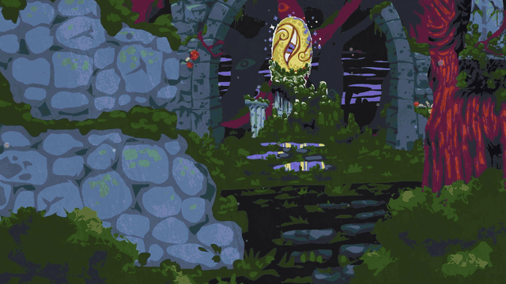
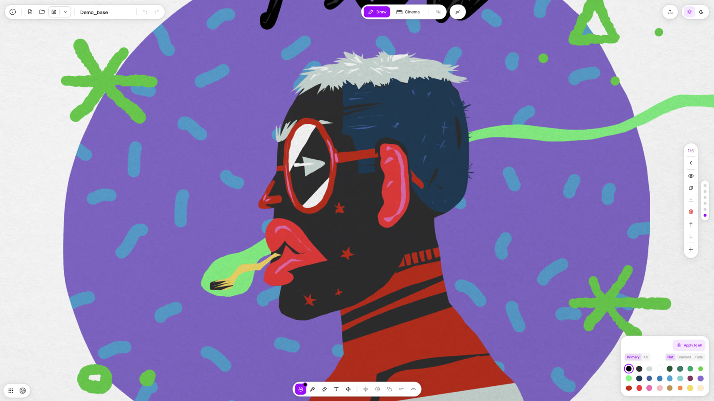
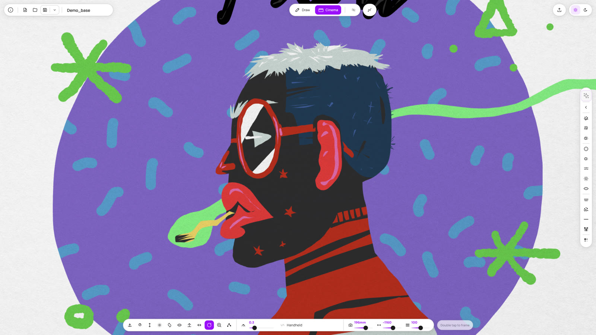

# Diorame



**Draw flat. Move in depth.**

Diorame is a free drawing tool for layered illustrations with real depth, a cinematic camera and a risograph look. You draw in 2D, layer by layer, and then move a camera through your own drawing. It runs in the browser, complete and free, on desktop and tablet.

**Use it → [diorame.com](https://diorame.com)** · App: [diorame.dumaker.com](https://diorame.dumaker.com) · Super Riso Lab: [super-riso.dumaker.com](https://super-riso.dumaker.com)

## Watch

| | English | Español |
|---|---|---|
| Introduction (2 min) | [Watch](https://youtu.be/MiXzFndPSzI) | [Ver](https://youtu.be/ds6Ui7qB6Yc) |
| Interface tour (2 min) | [Watch](https://youtu.be/CDC0PQLCHCQ) | [Ver](https://youtu.be/Xr5cw77hJls) |

## What it does

- **Draw:** two tools, Blob for colour masses and Brush for lines. Each layer is a distance: background far, foreground close.
- **Cinema:** one click and what you drew far stays far. Camera presets, depth of field, film and atmosphere FX.
- **Fixed palettes:** two risograph palettes, on purpose. Switching palette recolours the whole drawing.
- **Super Riso:** every frame turned into a print: risograph, photocopy or stencil.
- **Animation:** frame by frame, with onion skin.
- **Export:** video, PNG, SVG and the `.dior` project file. Send any drawing to the Super Riso Lab to fine-tune inks, paper and screening for high-res print.

Installable as a PWA. Desktop and tablet only, by design. English and Spanish.




## Stack

React 18 · TypeScript · Vite · Canvas 2D · WebGL2 (Super Riso) · Tailwind CSS v4

## Run locally

```bash
npm i
npm run dev
```

## Author

Made by [Dumaker](https://diorame.com), illustrator, with AI as a coding copilot that turns his design decisions into code.

## License

Public source under [CC BY-NC-SA 4.0](./LICENSE): free to use, share and adapt for non-commercial purposes, with attribution.
