# Informe de la sesión desatendida del 25 nov 2026 — carga, aviso de versión y apertura del Lab

Para Moisés. Publicado: **Diorame v3.26.88 → v3.26.94** y **Super Riso Lab v23.11 y v23.12**. Todo medido en un Chrome real
con perfiles desechables (nunca el tuyo), en local con un servidor que imita GitHub Pages y después en producción.
Herramientas y tabla completa: `tools/load-timing/README.md`.

## Causa de cada síntoma

**1. El modal de bienvenida tardaba en enseñar su imagen/vídeo.** No era una regresión (v3.26.52 y v3.26.87 cargan
igual: lienzo 1,08 s y vídeo 1,8 s a 10 Mbps, 3 pasadas cada una). El panel no tenía nada que enseñar hasta que llegaba
el vídeo (0,8–7,3 MB, uno al azar, siempre de la red) y el logo de 28 px era el PNG maestro de 1,6 MB. En una primera
carga (pestaña privada del iPad, perfil nuevo, recarga forzada) los dos compiten con 20 MB de texturas de papel y
grunge: a 10 Mbps el logo salía a los **6,5 s**. «Mejora tras varias recargas» = a partir de la segunda carga el service
worker sirve el shell y las texturas de su caché.

**2. El aviso de versión nueva tardaba.** El navegador solo pregunta por un `sw.js` nuevo al navegar o recargar. Con la
pestaña o la PWA abiertas durante un deploy (o la PWA reanudada en el iPad, que no recarga) **el aviso no salía nunca**
(medido: nada en 30 s tras volver a la pestaña). Al recargar sí salía, a los ~5 s a 10 Mbps.

**3. «No se ha podido abrir» al abrir el Lab.** Diorame se rendía **8 s después del clic**. El Lab tarda en arrancar lo que
tarda en compilar sus 19 programas WebGL, y los compilaba en serie (cada uno esperaba al anterior):
- con la caché de shaders del navegador caliente, 0,6 s; en frío, **8,0 s en v23.5 y 8,6 s en v23.8–v23.10** (+0,6 s y
  un programa más por el rotulador: tu sospecha era correcta, aunque no es lo único);
- **lo que cambió el 24 nov:** del 8 al 24 nov los shaders del Lab no cambiaron, así que la caché siempre estaba caliente
  y nunca viste el fallo. Ese día hubo tres deploys del Lab que cambiaron shaders (v23.6, v23.8, v23.9): cada uno
  invalidó la caché, y la primera apertura posterior tardó 6,0–6,6 s + ~1,7 s de la cadena de Diorame → justo en el
  tope de 8 s: a veces entraba y a veces no (reproducido: 9/10 y 1 fallo, todas ~10 s). v23.10 no cambió shaders: 0,6 s.
- **Segundo mecanismo, también real:** `dior-render.js` solo reexportaba chunks con hash que cada deploy renombra y
  borra; una copia en caché (GitHub Pages: 10 min) tras un deploy importaba archivos inexistentes → el Lab mostraba
  «No se pudo cargar el motor de Diorame». Reproducido con un servidor que sirve la copia vieja.

**Descartado con datos:** incidencia de GitHub Pages (githubstatus.com sin incidencias de Pages el 24–25 nov; el 408 fue
de un `git push`); «precache enorme que se invalida en cada versión» (era 4,3 MB, y una versión re-descarga 1,5–4,5 MB;
las texturas van aparte y sobreviven a los deploys); regresión de código entre v3.26.52 y v3.26.87; fallo de chunks de
la app en una pestaña sin service worker tras un deploy (no se reprodujo).

## Qué se cambió

| Versión | Cambio |
|---|---|
| Lab v23.11 | Los 19 programas se compilan a la vez y cada uno se comprueba al usarlo por primera vez. Mismo GLSL. Latido `superriso:loading` hacia Diorame. Reintento sin caché si falla importar `dior-render.js`. |
| v3.26.88 | Diorame espera al Lab mientras le llegue ese latido (20 s de silencio lo cortan), 60 s a un Lab antiguo, y corta al momento si cierras la pestaña. Toast de carga mientras tanto. |
| v3.26.89 | Póster (primer fotograma, WebP de 6–64 KB) en el vídeo de bienvenida y logo de 99 KB en lugar del de 1,6 MB. |
| v3.26.90 | Busca versión nueva al volver a la app y cada 30 min. |
| v3.26.91 | `dior-render.js` en un solo archivo, sin chunks (mismo SHA-256 que v3.26.87). Guardias de build: fallan si vuelve a importar chunks o si el precache engorda (> 3,5 MB, imágenes > 300 KB, vídeos). |
| v3.26.92 | Documentación (REFERENCE §8 «PWA and service worker», CLAUDE.md, `docs/ux-debt.md`). |
| Lab v23.12 + v3.26.93 | Tu feature: estado de carga del Lab al llegar desde Diorame (abajo) y «Abriendo en Super Riso Lab…» en Diorame hasta que el Lab confirma que tiene la escena. |
| v3.26.94 | Este informe y sus capturas. |

## Números antes / después

| Medida | Antes | Después |
|---|---|---|
| Lab en frío hasta estar listo | 8,0 s (v23.5) · 8,6 s (v23.8–v23.10) | **1,2 s** (producción: 1,2–1,4 s) |
| Primera apertura tras un deploy del Lab que cambia shaders | 6,0–6,6 s | ~1,2 s |
| Diorame → Lab, 20 aperturas con Chrome nuevo y sin caché de shaders | 9/10, ~10 s cada una | **producción 20/20, mediana 2,3 s** |
| Diorame → Lab, 20 aperturas reutilizando la pestaña | 20/20, 1,4 s | producción 20/20, 1,4 s |
| `dior-render.js` viejo en caché + deploy | el Lab falla | 3/3 OK |
| Logo del modal, primera carga a 10 Mbps | 6,5 s (producción 6,0 s) | 1,0–1,6 s |
| Imagen en el panel del vídeo, primera carga a 10 Mbps | nada hasta el vídeo (1,8 s) | póster a 0,8–1,3 s |
| Pestaña abierta durante un deploy, volver a ella | el aviso no sale | aviso a 0,34 s |
| PWA instalada v3.26.87 → v3.26.91 | — | aviso a 2,0 s, «Recargar» → v3.26.91, 0 errores |
| Precache del service worker | 4,30 MB | 2,82 MB |

Criterios de publicación: typecheck y 738/738 tests en verde; build con guardias en verde (y fallan, como deben, contra
el build real de v3.26.87); `pixcheck2` 7/7 a 0 px; `pixcheck` 6/7 a 0 px y el caso HQ ×2 a 1 px **igual que v3.26.87
contra sí mismo** (ruido del arnés); `flatcheck` 7/7, `flatAnimCheck` y `flatDistortCheck` en verde; `__diorRenderHash`
idéntico; `__cinemaHash` varía 1–207 px en los casos con FX igual que el código nuevo contra sí mismo (ruido, se informa).
Lab v23.11: 21 de 26 estilos idénticos y estables; los otros 5 ya variaban entre dos pasadas de v23.10 (el Lab no es
determinista en ellos), así que ahí no puedo afirmar «0 px»: el GLSL es el mismo.

## Tu feature: el Lab al llegar desde Diorame

Ya no aparece la imagen de ejemplo. Desde el primer instante, una pantalla a pantalla completa con el aspecto del Lab:
una hojita de papel con tres discos de trama riso (rosa flúor, azul, amarillo; cada trama a su ángulo) que se desregistran
y vuelven a registrarse despacio; quietos con «reducir movimiento». Las fases son las reales:

1. «Preparando las tintas…» mientras la página llega y arranca el motor (si tarda más de 6 s: «La primera vez tarda un poco más.»)
2. «Recibiendo tu escena de Diorame…»
3. «Dibujando tu escena…» (si tarda más de 6 s: «Las escenas grandes tardan un poco más.»)
4. Se desvanece cuando la vista previa está pintada.

Si falla: «No se ha podido abrir la escena», el motivo, **Reintentar** y **Descargar .dior** (el archivo que recibió). Si
no llega ninguna escena en 20 s: «Volver a Diorame» / «Ver la imagen de ejemplo». ES/EN según el idioma del navegador.
Probado con la escena de ejemplo (5,7 MB) y con una pesada (42 MB, 5 000 trazos en 6 capas), en claro y oscuro, también
con la red a 2 Mbps. Las capturas son del Lab real servido en local con el código publicado:

| | Claro | Oscuro |
|---|---|---|
| Arrancando (red lenta) | 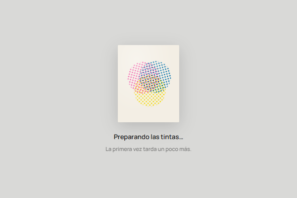 | 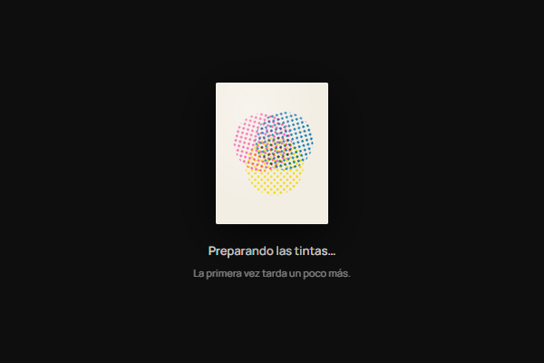 |
| Recibiendo | 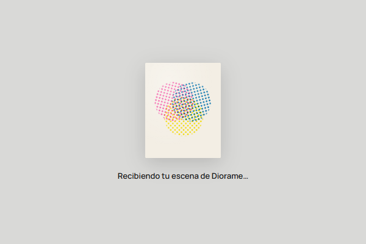 | |
| Dibujando | 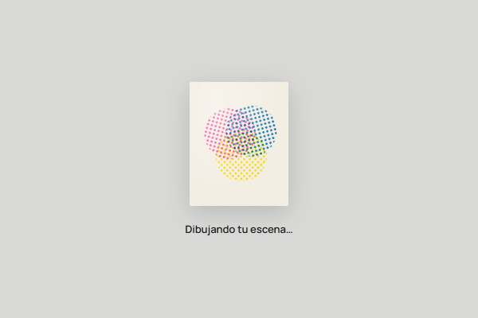 | 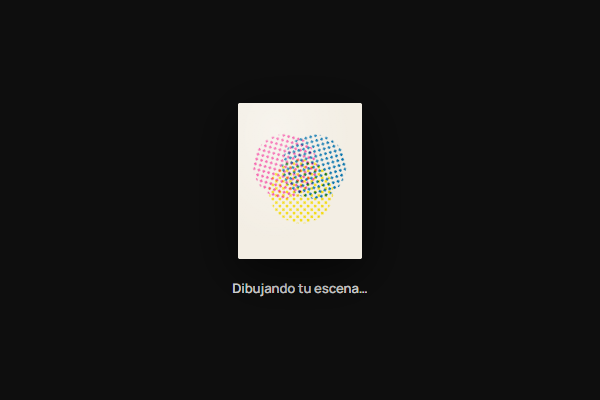 |
| Escena pintada | 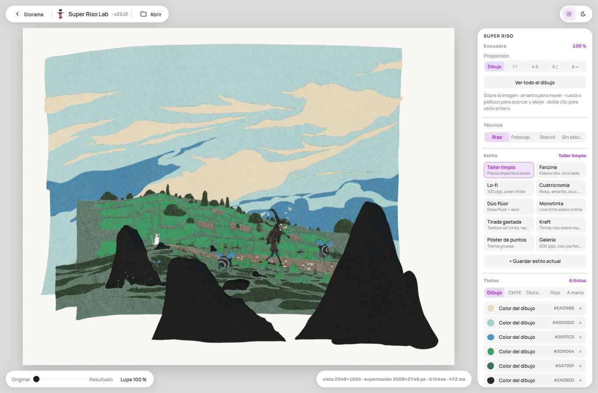 | 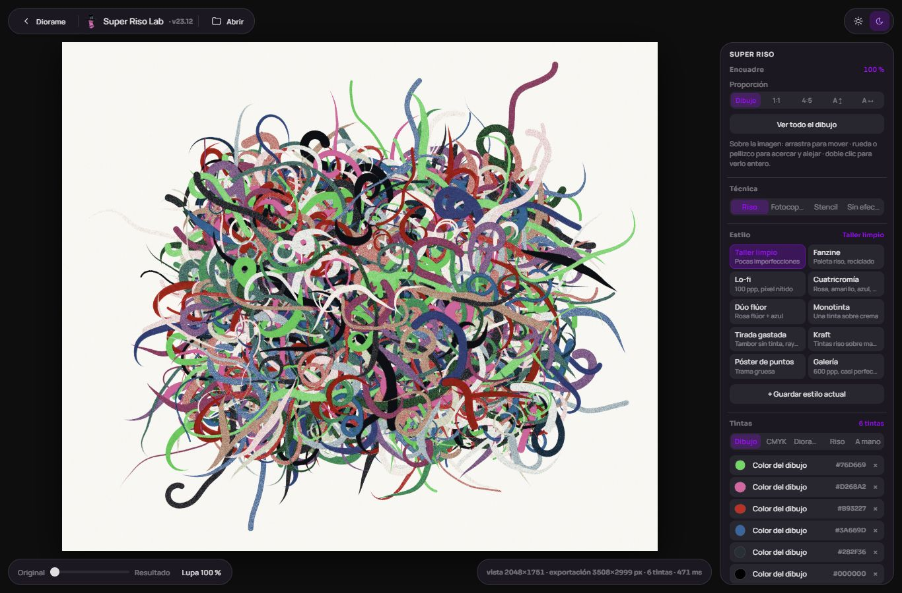 (escena pesada) |
| Error | 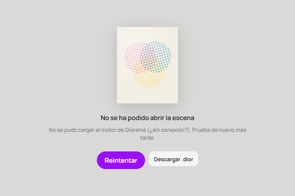 | 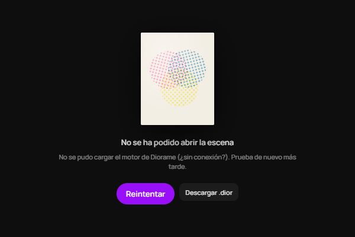 |
| Sin escena | 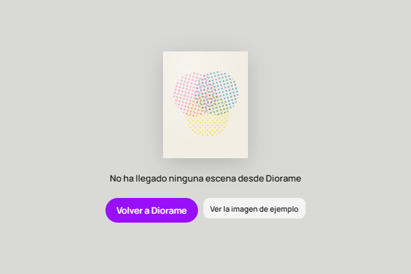 | |

En Diorame: 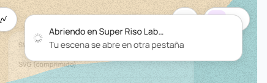

**Juicio visual pendiente tuyo:** el motivo, sus colores y el ritmo (2,6 s por ciclo) son una propuesta; los valores
están en el bloque `#dioLoad` del principio de `web/index.html` (y en `tools/studio/ui.src.html`).

## Lo que no se pudo resolver (detalle en `docs/ux-debt.md`)

- **iPad sin medir:** no tengo dispositivo; el WebKit de Windows no reproduce Safari. Tu prueba de abajo es la que vale.
- **Las texturas de papel y grunge pesan 20 MB** y se bajan en cada primera carga. Reducirlas cambia píxeles: decisión tuya.
- **La primera vez que el Lab abre un `.dior` baja también la textura de papel de Diorame (7 MB)**: a 2 Mbps la fase
  «Dibujando» dura ~30 s; a velocidades normales, 1–2 s. Las siguientes, desde caché.
- **El motor de Super Riso dentro de Diorame sigue compilando en serie** como el Lab hasta v23.10: activarlo en frío
  cuesta varios segundos. Portar el cambio de v23.11 es la continuación natural (no lo hice sin tu validación del Lab).

## Qué comprobar tú

1. **iPad, pestaña privada** en diorame.dumaker.com: el modal enseña al instante una imagen (el póster) y el vídeo entra
   después; la versión en pantalla es v3.26.94.
2. **iPad con la PWA instalada:** ábrela; debe salir «Nueva versión · Recargar» (si la tenías abierta, sal y vuelve a
   ella); recarga y confirma v3.26.94.
3. **PC, pestaña limpia y PWA instalada:** lo mismo.
4. **Abrir el Lab desde Diorame varias veces** (Exportar › Super Riso ↗), en el PC y en el iPad: en Diorame, «Abriendo en
   Super Riso Lab…»; en el Lab, la pantalla de carga y luego tu escena, nunca la imagen de ejemplo ni «No se ha podido
   abrir». Prueba también con una escena grande.
5. Mira la pantalla de carga con ojo de director de arte: motivo, colores, ritmo, textos.
